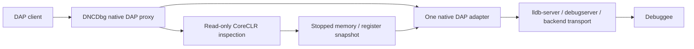

# Experimental native debugger backends and read-only CoreCLR inspection

**Experimental branch, not merge-ready.** Native-only CI does not establish
cross-platform managed-overlay support or resolve the remaining review gates.

DNCDbg has two deliberately separate modes:

- Default: the existing ICorDebug managed adapter, including managed source
  breakpoints, stepping, exception handling and evaluation.
- `--native-debugger=lldb|dap`: **one external native DAP execution controller**.
  Native symbols, persistent breakpoints, locals, expressions, stepping, module
  unload/reload and device transport belong to that debugger, not a new DNCDbg
  native engine.

The optional managed feature in native mode is **read-only CoreCLR inspection**,
not transparent mixed-mode debugging. It does not install managed source
breakpoints, step C#, control CLR exceptions, perform func-eval, mutate managed
variables, or subscribe to JIT/EnC execution notifications.

## Architecture decision



`NativeAdapterSession` is the swappable boundary: executable + argument list +
standard DAP. `lldb` selects LLDB discovery and its optional register/thread
inspection contract; `dap` accepts another explicitly installed DAP adapter
without assuming it implements LLDB-specific managed inspection. There is no
second process controller or generic two-debugger multiplexer.

`ICLRDebugging.OpenVirtualProcess` supplies the managed view through a read-only
`ICorDebugDataTarget`. Memory and registers come from the **same native adapter**.
No `DebugActiveProcess` managed attach, managed callback pipeline, CLR Stop or
CLR Continue is used in this mode. The data target exposes no write/control
interface. Releasing a virtual view is not detaching the native debugger.

Managed frames are matched to native frames only by **exact instruction-pointer
identity on the same OS thread, unique on both sides**. Ambiguous recursive or
duplicate PCs stay native rather than being assigned another frame's locals.
Unmatched native/JIT frames stay native; the
proxy does not append invented frames or guess their order. `[Managed]` frames
can expose portable-PDB source and primitive argument/local values. C/C++
variables and expressions remain native-backend operations.

Client frame, variable and source references have separate ownership and
lifetimes. Frame/variable IDs are not reused across native stops; managed
references additionally belong to a specific inspection generation. Source
references belong to one backend session. Reverse requests such as
`runInTerminal` retain their backend request identity through the proxy.
Remote frame, variable and source IDs are stored as signed 64-bit values;
client-facing IDs remain separate proxy-owned 32-bit values. Rejected launch,
attach or continue/step requests preserve the live stop epoch and references.
Resume epochs advance only after accepted control, a native event, or an
uncertain execution outcome, not merely when a request enters the queue.
Replies are bound to their originating backend generation. A client timeout or
failure produces a failed reply to that backend, never to its replacement.
Each native request has its own cancellation/timeout registration; one timeout
does not cancel unrelated requests. Explicitly failed startup releases launch admission
and a refused continue restores the previous partial-stop/all-stop state rather
than inventing an all-stop.
A timeout/transport failure is not a confirmed refusal: execution state is
unknown and managed inspection stays unavailable until a fresh stopped event.
An unsupported restart is rejected without expiring the unchanged stop/frames.
An unanswered startup retains admission, even without target evidence: process,
initialized or stopped events can precede its missing response. Disconnect or
reinitialize to reconcile the session before another launch.
The startup response deadline begins at `configurationDone`, not during IDE
breakpoint/configuration setup. An explicit failed startup response permits a
retry; a timeout does not establish absence of a target.
For backends that do not advertise `configurationDone`, the deadline starts
with startup instead, so the absence of that optional phase cannot hang launch.

Writes use a cancellable async serialization gate and bounded async pipe
write/flush awaits. Cancellation while waiting for the gate does not affect
another request. Interruption after a frame starts makes that transport
unusable; the proxy never appends a new frame to a potentially partial one.
EOF cancels requests and stops/aborts the native transport **before** joining
its request worker. The pipe-fill tests prove worker admission by consuming
only the next header and one payload byte before the backend stops reading.

## Find an installed debugger

```sh
./bin/dncdbg-dap --native-debugger=lldb --native-debugger-info
./bin/dncdbg-dap --native-debugger=lldb
```

Discovery prefers the selected Xcode toolchain in place (`xcrun --find
lldb-dap`), then PATH, Android SDK/NDK host-adapter locations, and finally an
explicitly declared app-local upstream LLVM bundle. Missing/non-executable tools
and failed version probes are reported, not silently replaced by the retired
controller. An explicit path never falls back:

```sh
./bin/dncdbg-dap --native-debugger=lldb \
  --native-debugger-path=/path/to/lldb-dap
./bin/dncdbg-dap --native-debugger=dap \
  --native-debugger-path=/path/to/another-public-dap-adapter \
  --native-debugger-arg=--stdio
```

Arguments are individual argv entries, not shell text. The LLDB CLI `lldb`,
target-side `lldb-server`, and Apple `debugserver` are not DAP adapters and are
not substituted for `lldb-dap`. Older toolchains may call the adapter
`lldb-vscode`.

The version probe distinguishes LLVM's adapter version from liblldb's runtime
version (notably Xcode's `21.0.0` versus `2103...`). If DAP reports a different
liblldb identity than the probe, initialization fails.
The version subprocess has redirected, closed stdin and cannot consume the
client's DAP initialize bytes. Adapters without CLI `--version` are probed by
public DAP initialize/version instead. Candidates must actually execute; merely
finding an executable is not a usable-toolchain check.

The Windows runner's public LLVM imports `python310.dll`. Its CI lane installs
public CPython 3.10 with `actions/setup-python`, checks `liblldb.dll` imports
using `llvm-readobj`, and places the matching DLL directory on PATH. CPython's
PSF-2.0 license and bundled notices apply; it is a host-tool dependency, not
redistributed by DNCDbg. An incompatible Python ABI is not a substitute.

## Supply an upstream LLVM bundle

No debugger binary is downloaded or redistributed by this repository.
To supply a legally distributable upstream LLVM release, retain its **complete
runtime layout**, libraries, notices, dependencies and server tools. Put a
`native-adapter.json` at its root:

```json
{
  "provider": "llvm",
  "licenseExpression": "Apache-2.0 WITH LLVM-exception",
  "licenseFile": "LICENSE.TXT",
  "rid": "linux-x64",
  "version": "21.1.8",
  "executable": "bin/lldb-dap"
}
```

Select that directory with `--native-debugger-path=/path/to/bundle`, or place it
under `native-debuggers/lldb/<host-rid>/` beside the adapter for discovery.
The RID, executable version, contained paths, license declaration and license
file are checked. These are packaging checks, not a legal audit of arbitrary
third-party contents. Do **not** label/repackage Xcode as an upstream LLVM bundle.
Xcode is discovered and executed in place under its own distribution terms.
Bundle roots are normalized without trailing separators. Manifest, executable
and license paths are checked after resolving file and ancestor-directory
symlinks; they must remain inside the resolved bundle root.

LLVM/LLDB is **Apache-2.0 WITH LLVM-exception**. Existing ClrDebug and DbgShim
dependencies remain MIT. Native mode adds no native debugger NuGet package and
does not redistribute DbgEng, WinDbg, vsdbg, Xcode binaries or private device
components.

## Local .NET inspection

Launch the public native host executable rather than attaching a second managed
debugger. For example, after initialize:

```json
{
  "command": "launch",
  "arguments": {
    "program": "/absolute/path/to/dotnet",
    "args": ["/absolute/path/to/ConsoleApp.dll"],
    "managedInspection": true
  }
}
```

Use the native adapter's ordinary source/function/instruction breakpoints.
`setBreakpoints` on `.cs` explicitly fails in native mode. At a native stop,
`stackTrace` can enrich matching JIT frames; `scopes`, `variables` and lookup of
a scalar local/argument name use the read-only view for those frames.
Calls, arithmetic C# expressions, properties and managed mutation fail with a
read-only diagnostic. Native-frame evaluation is forwarded to the native engine.
For LLDB, `watch` and `hover` use its read-only **hover** variable-path lookup
(`eDynamicDontRunTarget`), never its fallback expression parser. They preserve
managed references and do not produce an invalidation/IDE refresh loop. Use an
explicit native REPL evaluation for arbitrary expressions or commands; those
can execute/mutate the native target and invalidate managed inspection.

`dotnet/nativeStackTrace` returns the un-enriched native view.
`dotnet/managedStackTrace` requests strict read-only managed inspection.
Its frame IDs use the same proxy-owned namespace as `stackTrace` and can be
passed to `scopes`. Native locals references retain their owning frame: LLDB's
static variables references and mutable selected frame must not alias another
thread/frame selected during internal register inspection.
`dotnet/info` reports the execution owner, native-adapter PID, actual debuggee
PID, stop generation and managed snapshot serial. If optional enrichment is
unavailable, native frames remain usable but the response includes
`dncdbgManagedInspection.status:"unavailable"` and a visible diagnostic; it is
not a successful managed-debugging result.
The backend must advertise `supportsReadMemoryRequest` before any CoreCLR
module/DAC lookup. Older adapters without memory reads remain native-only;
the proxy must not send them an unknown `readMemory` request. Malformed,
missing or incompatible inspection metadata produces explicit
`status:"unavailable"` while preserving native stack frames. Cancellation
still rejects the request instead of returning a stale stack.

The CLR view requires an all-threads-stopped, matching-host, little-endian,
64-bit CoreCLR target. A module image/header check guards OS/CPU/endianness.
DbgShim's provider3 library lookup validates native build IDs (or Windows image
identity) for DAC/DBI; on-disk managed PE metadata must match the loaded MVID.
An explicit directory is **pinned**, with no installed-runtime fallback:

```json
{ "managedInspection": { "runtime": "coreclr", "runtimeDirectory": "/exact/runtime/directory" } }
```

The stop-owned 4 KiB memory cache is never shared between snapshots. Resume,
native mutation/evaluation, module changes, target exit and reinitialization
invalidate the view and its managed references. Active reads are cancellable;
a result from an expired stop is rejected. No native/managed object heap
enumeration or GC-suspension consistency is claimed: this provider exposes
stack frames and primitive scalar values, not a general heap/func-eval engine.
Hardware-debug/SVE register banks are not part of the managed inspection view.
ARM64 `fp`/`lr` and `x29`/`x30` aliases are accepted; unrequested floating-point
banks are not required. Requested-but-missing registers fail inspection instead
of supplying invented zero values. Partial memory reads retain their valid
prefix when the next page is unmapped.

Native REPL evaluation or successful breakpoint mutation at a stop expires the managed view.
Clients must advertise `supportsInvalidatedEvent` to mutate an active managed
view; the proxy sends stacks/variables invalidation and the client refreshes.
Backend frame-scoped invalidation is broadened to stacks/variables instead of
leaking backend frame IDs. Unsupported cancel/restart capabilities stay masked
on both initialize and later capability events.
Frame-less native evaluation restores the last explicit client frame, rather
than inheriting an internal register read's selected frame. Binary-formatted
x64 EFLAGS is supported. If the backend omits optional MXCSR, integer/control
context remains usable but the floating-point validity flag is cleared and a
diagnostic is emitted; no floating-point bank is fabricated.

### Execution versus inspection matrix

| Feature | Native mode |
| --- | --- |
| Native launch, persistent native breakpoints, variables, C/C++ evaluation, stepping | Owned by the selected native adapter |
| Native-only attach | Forwarded to the native adapter; real CoreCLR attach/continue is unproven, not supported as a mixed inspection result |
| Attach with managed inspection; proxy restart | Explicitly rejected until real post-continue/restart contracts are green; disconnect/reinitialize instead |
| Managed stack/source and primitive local/argument inspection | Optional read-only CoreCLR provider; matching local metadata/runtime required |
| Native/managed frame correlation | Exact same-thread PC match only |
| Managed source breakpoints, managed stepping, CLR exception filters, managed func-eval/mutation | **Not implemented**; use normal managed mode |
| JIT/EnC notifications, managed breakpoint rebind across tiered/R2R code | **Not implemented**; there are no managed code patches to rebind |
| Single-file/dynamic/missing local PE/PDB named-source parity | Not claimed; missing metadata is explicitly unavailable or lacks source/names |
| Mono and NativeAOT managed inspection | Not implemented; native backend remains usable without this provider |
| Remote/device managed inspection | Not implemented; native transport/configuration is forwarded to the backend |
| DAP request-id cancellation | Not advertised: pause/disconnect interrupt inspection, but proxy/client request IDs are not forwarded as native cancellation IDs |

### Detach and I/O ownership

Native detach is passed to the backend. An accepted `terminateDebuggee:false`
relinquishes ownership: even if the adapter then stalls, cleanup may kill only
the adapter, not its detached target tree. Attach-session EOF similarly defaults
to detach; a launched target defaults to termination.
Refused non-terminating detach keeps the session alive and its non-termination
intent sticky. Cleanup must not reinterpret that refusal as permission to
terminate the target.
An unanswered disconnect has unknown outcome, not a confirmed refusal: it must
not restore stopped/all-stop state or access modules/DAC without a fresh stopped
event. Only an explicit failed response can restore the prior stop.

For a launched inferior, give stdio an independent terminal/file before
detaching. LLDB's internal-console pipes can otherwise close with the debugger
and the application's later writes can fail. The tests use documented
`preRunCommands` setting `target.output-path` and `target.error-path`; LLDB 22+
also documents `stdio`. This is backend I/O lifetime, not CLR stop coordination.

## Linux, Android and iOS backends

The native DAP executable is a **host** tool. Linux/Android use the appropriate
target-architecture `lldb-server`; Apple platforms use their supported
`debugserver`/platform transport. These server binaries are not interchangeable
with the host DAP adapter.

Android SDK/NDK or Android Studio may supply LLDB/server tooling, but an
installation is not assumed to contain `lldb-dap`. A system/upstream host DAP
adapter can instead connect using LLDB's public `remote-android` platform and
the toolchain's matching server. Device selection, adb forwarding, app
debuggability, deployment and target ABI/server compatibility remain platform
setup, not automatic DNCDbg features.

For Linux, forward the backend's public `remote-linux` platform or gdb-remote
configuration. Bind local server/forwarded ports to loopback unless a secured
transport is deliberately configured. For iOS, use the installed Xcode
toolchain and supported device platform: pairing, Developer Mode,
developer signing/provisioning and `get-task-allow` entitlements still apply.
No private Apple debugger component is downloaded or bundled.

Native `initCommands`, `preRunCommands`, `launchCommands`, `attachCommands` and
other backend arguments are forwarded rather than implemented here. Remote or
custom launch commands cannot opt into the current local CoreCLR provider.
The managed provider rejects pre/post/stop/exit/terminate commands, alternate
triples/platforms and remote launch vectors. The only pre-run command exception
is a literal `settings set target.output-path "..."` or
`settings set target.error-path "..."` to give detached target I/O an independent
file lifetime; embedded command/expression text is not allowed.
This is an extensible native backend architecture, **not** a claim that
Android/iOS deployment or Mono/AOT managed debugging is validated.

## Reproduce the proof and proxy contracts

```sh
dotnet publish src/DncDbg.Dap -c Release -o bin
python3 tests/DncDbg.MixedModeTests/native_proxy.py \
  --adapter bin/dncdbg-dap --lldb-dap "$(xcrun --find lldb-dap)"
python3 tests/DncDbg.MixedModeTests/proxy_contracts.py \
  --adapter bin/dncdbg-dap --lldb-dap "$(xcrun --find lldb-dap)"
```

Use `--native-only` on `native_proxy.py` to exercise the native backend without
claiming managed inspection. CMake and a public host compiler build the isolated
C fixture. Python uses only the standard library.

The fixture's optional `DNCDBG_MIXED_CHECKPOINTS=1` enables **test-only native
checkpoints**, before P/Invoke work and after the managed result is assigned.
They are a documented substitute for a managed source breakpoint in this proof,
not a production runtime notification mechanism. Persistent checkpoint identity,
native source/locals/step (`sum=42`), exact thread/PC correlation, fresh managed
snapshots (`19,23`, then `result=42`), continue, actual process exit, detach and
EOF cleanup are checked. No checkpoint hook is installed by production code.

`LldbProof` is the independent raw public-API baseline. Before proxy
implementation, the CLI test failed with `Unknown option --native-debugger=lldb`
and the retirement test failed because the old Windows flag was still accepted.
Additional deterministic DAP peers/relays exercise ID collisions, reverse
requests, reinitialization, missing/version-mismatched adapters, malformed DAP,
pinned missing/poisoned DAC libraries, expired reads, target exit and lost
backend connection. A held memory-read barrier is implemented only in a test
relay, not as a production injection hook.

### Proof scope and remaining merge gates

The complete local JIT/scalar overlay has been proven on **macOS 27.0.1 arm64,
CoreCLR 10.0.12, Xcode liblldb 2103.0.34.103**, using the fixture's cooperative
native checkpoints. It is not a cross-platform managed execution claim.
The active workflow gates native-only LLDB relay/lifecycle and generic ownership
contracts separately on macOS, Linux and Windows. Strict managed-overlay
assertions run only when that explicitly proven configuration matches; other
runner configurations are reported unproven, not converted into managed passes.
Native launch configuration is backend-specific: the fixture uses LLDB's
backwards-compatible `env:["NAME=value"]` form. LLVM 18's public launch handler
reads a string array and silently ignores the newer object representation;
DNCDbg forwards configuration rather than inventing a universal launch schema.

[Run 40085975520](https://github.com/mattleibow/dncdbg/actions/runs/40085975520)
was red: macOS/Linux failed before DAC open because older LLDB serializes
`Module.addressRange` in **decimal**, while the initial proxy required `0x`;
Windows could not load `python310.dll`. Public
[LLVM 18 JSONUtils.cpp](https://github.com/llvm/llvm-project/blob/llvmorg-18.1.8/lldb/tools/lldb-dap/JSONUtils.cpp#L492-L494)
uses `std::to_string(GetObjectFileHeaderAddress().GetLoadAddress())`. A
real-LLDB relay reproduced that decimal representation, failed with
`The native adapter did not expose the CoreCLR module's load address.`, then
passed strict managed frame/locals assertions after the parser fix. This
addresses the known representation failure, not every DAC/ABI/stop combination
on the previously red CI configurations.

[Run 40087105817](https://github.com/mattleibow/dncdbg/actions/runs/40087105817)
proved native-only relay/lifecycle, deterministic contracts and managed
regressions on macOS and Windows (including the public Python dependency fix).
Linux remained red because LLVM 18 ignored the fixture's object-shaped `env`,
so the required checkpoint was never enabled and the first stop was
`native_sum`. The fixture now supplies the public string-array form; stop-order,
persistent identity, locals, stepping and lifecycle assertions are unchanged.

The new timeout/control regressions were red before their production fixes:

| Contract | Exact pre-fix failure | Post-fix result |
| --- | --- | --- |
| One native request times out while another is pending | `TaskCanceledException: A task was canceled.` on the unrelated task | Unrelated request completes after its own reply |
| Startup timeout, then retry launch | `A native target is already active. Reinitialize or use the native backend's restart request.` | Superseded by review: only explicit startup failure releases admission; timeout requires reconciliation |
| Client does not answer reverse request | `Reverse timeout left the originating backend unanswered: None` | Origin receives failed `request_seq:500` response |
| Continue refused at partial stop | Inspection reaches CoreCLR lookup instead of the `all-threads-stopped` guard | Prior partial-stop state preserved |
| Managed attach before proof | `success:True` | Explicit unsupported attach error; restart is also rejected |

Exact transcripts are retained in `evidence/proxy-lifecycle-red-green.txt`
under `tests/DncDbg.MixedModeTests`; complete protocol captures and prior reds
remain under ignored `build/validation/mixed-mode/`. No prior red evidence or
managed assertion was replaced by a weaker assertion.
The workflow also emits a notice, job summary and `proof-disposition.json`
artifact distinguishing overlay **SKIP** from native-only success.

The expanded review's register test was red on both public Linux and Windows
x64 in [run 40090679373](https://github.com/mattleibow/dncdbg/actions/runs/40090679373):
`An absent optional MXCSR lost the valid integer/control context.` This was a
test-only commit before the register fix. Additional exact red/green excerpts
are committed in `evidence/expanded-proxy-review-red-green.txt`.

Real attach reached SIGSTOP with a verified native checkpoint breakpoint, but
did not reach the checkpoint after continue. The current Xcode adapter also
does not advertise restart. The strict, deliberately failing research gates
remain available with `proxy_contracts.py --attach-restart-proof`; those
operations are not supported merely because launch inspection works.
Blocked-write timeout/EOF shutdown now pass deterministic pipe-fill gates.
Actual CoreCLR runtime unload/reload, recursive
identical-PC overlay, malformed/missing metadata degradation, and real device
sessions remain unproven merge gates. Generic transport fault tests do not
substitute for those real-target proofs.

ReadyToRun native-only relay passes locally, but named managed overlay is
partial (the fixture's `ManagedCall` can be absent as an IL frame). The public
`DOTNET_ReadyToRun=0` setting on the same artifact restores the JIT-only proof;
it does not prove R2R parity. Tiering enabled/disabled launch configurations
passed, not actual promotion/ReJIT/EnC notifications. Single-file native-only
lifecycle passes; a statically linked/runtime-in-app image has no separately
loaded CoreCLR module and managed inspection explicitly reports unavailable.
Missing/nonnamable PE metadata is not silently claimed as named-source support.

### Public references

- [LLDB DAP distribution/configuration](https://lldb.llvm.org/use/lldbdap.html)
  and [public DAP extensions](https://lldb.llvm.org/resources/lldbdap-extensions.html).
- [Public LLDB hover evaluation](https://github.com/llvm/llvm-project/blob/llvmorg-18.1.8/lldb/tools/lldb-dap/lldb-dap.cpp#L1316-L1330):
  variable-path lookup with `eDynamicDontRunTarget`; no expression-parser fallback for hover.
- [LLDB remote platforms/server architecture](https://lldb.llvm.org/use/remote.html).
- [Android NDK native debugging](https://developer.android.com/ndk/guides/debug).
- [ICLRDebugging.OpenVirtualProcess](https://learn.microsoft.com/dotnet/framework/unmanaged-api/debugging/iclrdebugging-openvirtualprocess-method)
  and [ICorDebugDataTarget](https://learn.microsoft.com/dotnet/core/unmanaged-api/debugging/icordebug/icordebugdatatarget-interface).
- Public context/platform ABI: .NET runtime
  [`cordebug.idl`](https://github.com/dotnet/runtime/blob/v10.0.12/src/coreclr/inc/cordebug.idl)
  and [`pal.h`](https://github.com/dotnet/runtime/blob/v10.0.12/src/coreclr/pal/inc/pal.h).
- [LLVM license](https://github.com/llvm/llvm-project/blob/llvmorg-21.1.8/lldb/LICENSE.TXT).
