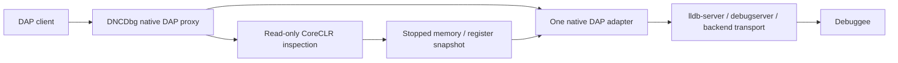

# Native debugger backends and read-only CoreCLR inspection

DNCDbg has two deliberately separate modes:

- Default: the existing ICorDebug managed adapter, including managed source
  breakpoints, stepping, exception handling and evaluation.
- `--native-debugger=lldb|dap`: **one external native DAP execution controller**.
  Native symbols, persistent breakpoints, locals, expressions, stepping, module
  unload/reload and device transport belong to that debugger, not a new DNCDbg
  native engine.

The optional managed feature in native mode is **read-only CoreCLR inspection**,
not transparent mixed-mode debugging. It does not install managed source
breakpoints, step C#, control CLR exceptions, perform func-eval, mutate managed
variables, or subscribe to JIT/EnC execution notifications.

## Architecture decision



`NativeAdapterSession` is the swappable boundary: executable + argument list +
standard DAP. `lldb` selects LLDB discovery and its optional register/thread
inspection contract; `dap` accepts another explicitly installed DAP adapter
without assuming it implements LLDB-specific managed inspection. There is no
second process controller or generic two-debugger multiplexer.

`ICLRDebugging.OpenVirtualProcess` supplies the managed view through a read-only
`ICorDebugDataTarget`. Memory and registers come from the **same native adapter**.
No `DebugActiveProcess` managed attach, managed callback pipeline, CLR Stop or
CLR Continue is used in this mode. The data target exposes no write/control
interface. Releasing a virtual view is not detaching the native debugger.

Managed frames are matched to native frames only by **exact instruction-pointer
identity on the same OS thread**. Unmatched native/JIT frames stay native; the
proxy does not append invented frames or guess their order. `[Managed]` frames
can expose portable-PDB source and primitive argument/local values. C/C++
variables and expressions remain native-backend operations.

Client frame, variable and source references have separate ownership and
lifetimes. Frame/variable IDs are not reused across native stops; managed
references additionally belong to a specific inspection generation. Source
references belong to one backend session. Reverse requests such as
`runInTerminal` retain their backend request identity through the proxy.

## Find an installed debugger

```sh
./bin/dncdbg-dap --native-debugger=lldb --native-debugger-info
./bin/dncdbg-dap --native-debugger=lldb
```

Discovery prefers the selected Xcode toolchain in place (`xcrun --find
lldb-dap`), then PATH, Android SDK/NDK host-adapter locations, and finally an
explicitly declared app-local upstream LLVM bundle. Missing/non-executable tools
and failed version probes are reported, not silently replaced by the retired
controller. An explicit path never falls back:

```sh
./bin/dncdbg-dap --native-debugger=lldb \
  --native-debugger-path=/path/to/lldb-dap
./bin/dncdbg-dap --native-debugger=dap \
  --native-debugger-path=/path/to/another-public-dap-adapter \
  --native-debugger-arg=--stdio
```

Arguments are individual argv entries, not shell text. The LLDB CLI `lldb`,
target-side `lldb-server`, and Apple `debugserver` are not DAP adapters and are
not substituted for `lldb-dap`. Older toolchains may call the adapter
`lldb-vscode`.

The version probe distinguishes LLVM's adapter version from liblldb's runtime
version (notably Xcode's `21.0.0` versus `2103...`). If DAP reports a different
liblldb identity than the probe, initialization fails.

## Supply an upstream LLVM bundle

No debugger binary is downloaded or redistributed by this repository.
To supply a legally distributable upstream LLVM release, retain its **complete
runtime layout**, libraries, notices, dependencies and server tools. Put a
`native-adapter.json` at its root:

```json
{
  "provider": "llvm",
  "licenseExpression": "Apache-2.0 WITH LLVM-exception",
  "licenseFile": "LICENSE.TXT",
  "rid": "linux-x64",
  "version": "21.1.8",
  "executable": "bin/lldb-dap"
}
```

Select that directory with `--native-debugger-path=/path/to/bundle`, or place it
under `native-debuggers/lldb/<host-rid>/` beside the adapter for discovery.
The RID, executable version, contained paths, license declaration and license
file are checked. These are packaging checks, not a legal audit of arbitrary
third-party contents. Do **not** label/repackage Xcode as an upstream LLVM bundle.
Xcode is discovered and executed in place under its own distribution terms.

LLVM/LLDB is **Apache-2.0 WITH LLVM-exception**. Existing ClrDebug and DbgShim
dependencies remain MIT. Native mode adds no native debugger NuGet package and
does not redistribute DbgEng, WinDbg, vsdbg, Xcode binaries or private device
components.

## Local .NET inspection

Launch the public native host executable rather than attaching a second managed
debugger. For example, after initialize:

```json
{
  "command": "launch",
  "arguments": {
    "program": "/absolute/path/to/dotnet",
    "args": ["/absolute/path/to/ConsoleApp.dll"],
    "managedInspection": true
  }
}
```

Use the native adapter's ordinary source/function/instruction breakpoints.
`setBreakpoints` on `.cs` explicitly fails in native mode. At a native stop,
`stackTrace` can enrich matching JIT frames; `scopes`, `variables` and lookup of
a scalar local/argument name use the read-only view for those frames.
Calls, arithmetic C# expressions, properties and managed mutation fail with a
read-only diagnostic. Native-frame evaluation is forwarded to the native engine.

`dotnet/nativeStackTrace` returns the un-enriched native view.
`dotnet/managedStackTrace` requests strict read-only managed inspection.
`dotnet/info` reports the execution owner, native-adapter PID, actual debuggee
PID, stop generation and managed snapshot serial. If optional enrichment is
unavailable, native frames remain usable but the response includes
`dncdbgManagedInspection.status:"unavailable"` and a visible diagnostic; it is
not a successful managed-debugging result.

The CLR view requires an all-threads-stopped, matching-host, little-endian,
64-bit CoreCLR target. A module image/header check guards OS/CPU/endianness.
DbgShim's provider3 library lookup validates native build IDs (or Windows image
identity) for DAC/DBI; on-disk managed PE metadata must match the loaded MVID.
An explicit directory is **pinned**, with no installed-runtime fallback:

```json
{ "managedInspection": { "runtime": "coreclr", "runtimeDirectory": "/exact/runtime/directory" } }
```

The stop-owned 4 KiB memory cache is never shared between snapshots. Resume,
native mutation/evaluation, module changes, target exit and reinitialization
invalidate the view and its managed references. Active reads are cancellable;
a result from an expired stop is rejected. No native/managed object heap
enumeration or GC-suspension consistency is claimed: this provider exposes
stack frames and primitive scalar values, not a general heap/func-eval engine.
Hardware-debug/SVE register banks are not part of the managed inspection view.

### Execution versus inspection matrix

| Feature | Native mode |
| --- | --- |
| Native launch/attach, persistent native breakpoints, variables, C/C++ evaluation, stepping | Owned by the selected native adapter and its advertised capabilities |
| Managed stack/source and primitive local/argument inspection | Optional read-only CoreCLR provider; matching local metadata/runtime required |
| Native/managed frame correlation | Exact same-thread PC match only |
| Managed source breakpoints, managed stepping, CLR exception filters, managed func-eval/mutation | **Not implemented**; use normal managed mode |
| JIT/EnC notifications, managed breakpoint rebind across tiered/R2R code | **Not implemented**; there are no managed code patches to rebind |
| Single-file/dynamic/missing local PE/PDB named-source parity | Not claimed; missing metadata is explicitly unavailable or lacks source/names |
| Mono and NativeAOT managed inspection | Not implemented; native backend remains usable without this provider |
| Remote/device managed inspection | Not implemented; native transport/configuration is forwarded to the backend |
| DAP request-id cancellation | Not advertised: pause/disconnect interrupt inspection, but proxy/client request IDs are not forwarded as native cancellation IDs |

### Detach and I/O ownership

Native detach is passed to the backend. An accepted `terminateDebuggee:false`
relinquishes ownership: even if the adapter then stalls, cleanup may kill only
the adapter, not its detached target tree. Attach-session EOF similarly defaults
to detach; a launched target defaults to termination.

For a launched inferior, give stdio an independent terminal/file before
detaching. LLDB's internal-console pipes can otherwise close with the debugger
and the application's later writes can fail. The tests use documented
`preRunCommands` setting `target.output-path` and `target.error-path`; LLDB 22+
also documents `stdio`. This is backend I/O lifetime, not CLR stop coordination.

## Linux, Android and iOS backends

The native DAP executable is a **host** tool. Linux/Android use the appropriate
target-architecture `lldb-server`; Apple platforms use their supported
`debugserver`/platform transport. These server binaries are not interchangeable
with the host DAP adapter.

Android SDK/NDK or Android Studio may supply LLDB/server tooling, but an
installation is not assumed to contain `lldb-dap`. A system/upstream host DAP
adapter can instead connect using LLDB's public `remote-android` platform and
the toolchain's matching server. Device selection, adb forwarding, app
debuggability, deployment and target ABI/server compatibility remain platform
setup, not automatic DNCDbg features.

For Linux, forward the backend's public `remote-linux` platform or gdb-remote
configuration. Bind local server/forwarded ports to loopback unless a secured
transport is deliberately configured. For iOS, use the installed Xcode
toolchain and supported device platform: pairing, Developer Mode,
developer signing/provisioning and `get-task-allow` entitlements still apply.
No private Apple debugger component is downloaded or bundled.

Native `initCommands`, `preRunCommands`, `launchCommands`, `attachCommands` and
other backend arguments are forwarded rather than implemented here. Remote or
custom launch commands cannot opt into the current local CoreCLR provider.
This is an extensible native backend architecture, **not** a claim that
Android/iOS deployment or Mono/AOT managed debugging is validated.

## Reproduce the proof and proxy contracts

```sh
dotnet publish src/DncDbg.Dap -c Release -o bin
python3 tests/DncDbg.MixedModeTests/native_proxy.py \
  --adapter bin/dncdbg-dap --lldb-dap "$(xcrun --find lldb-dap)"
python3 tests/DncDbg.MixedModeTests/proxy_contracts.py \
  --adapter bin/dncdbg-dap --lldb-dap "$(xcrun --find lldb-dap)"
```

Use `--native-only` on `native_proxy.py` to exercise the native backend without
claiming managed inspection. CMake and a public host compiler build the isolated
C fixture. Python uses only the standard library.

The fixture's optional `DNCDBG_MIXED_CHECKPOINTS=1` enables **test-only native
checkpoints**, before P/Invoke work and after the managed result is assigned.
They are a documented substitute for a managed source breakpoint in this proof,
not a production runtime notification mechanism. Persistent checkpoint identity,
native source/locals/step (`sum=42`), exact thread/PC correlation, fresh managed
snapshots (`19,23`, then `result=42`), continue, actual process exit, detach and
EOF cleanup are checked. No checkpoint hook is installed by production code.

`LldbProof` is the independent raw public-API baseline. Before proxy
implementation, the CLI test failed with `Unknown option --native-debugger=lldb`
and the retirement test failed because the old Windows flag was still accepted.
Additional deterministic DAP peers/relays exercise ID collisions, reverse
requests, reinitialization, missing/version-mismatched adapters, malformed DAP,
pinned missing/poisoned DAC libraries, expired reads, target exit and lost
backend connection. A held memory-read barrier is implemented only in a test
relay, not as a production injection hook.

### Public references

- [LLDB DAP distribution/configuration](https://lldb.llvm.org/use/lldbdap.html)
  and [public DAP extensions](https://lldb.llvm.org/resources/lldbdap-extensions.html).
- [LLDB remote platforms/server architecture](https://lldb.llvm.org/use/remote.html).
- [Android NDK native debugging](https://developer.android.com/ndk/guides/debug).
- [ICLRDebugging.OpenVirtualProcess](https://learn.microsoft.com/dotnet/framework/unmanaged-api/debugging/iclrdebugging-openvirtualprocess-method)
  and [ICorDebugDataTarget](https://learn.microsoft.com/dotnet/core/unmanaged-api/debugging/icordebug/icordebugdatatarget-interface).
- Public context/platform ABI: .NET runtime
  [`cordebug.idl`](https://github.com/dotnet/runtime/blob/v10.0.12/src/coreclr/inc/cordebug.idl)
  and [`pal.h`](https://github.com/dotnet/runtime/blob/v10.0.12/src/coreclr/pal/inc/pal.h).
- [LLVM license](https://github.com/llvm/llvm-project/blob/llvmorg-21.1.8/lldb/LICENSE.TXT).
